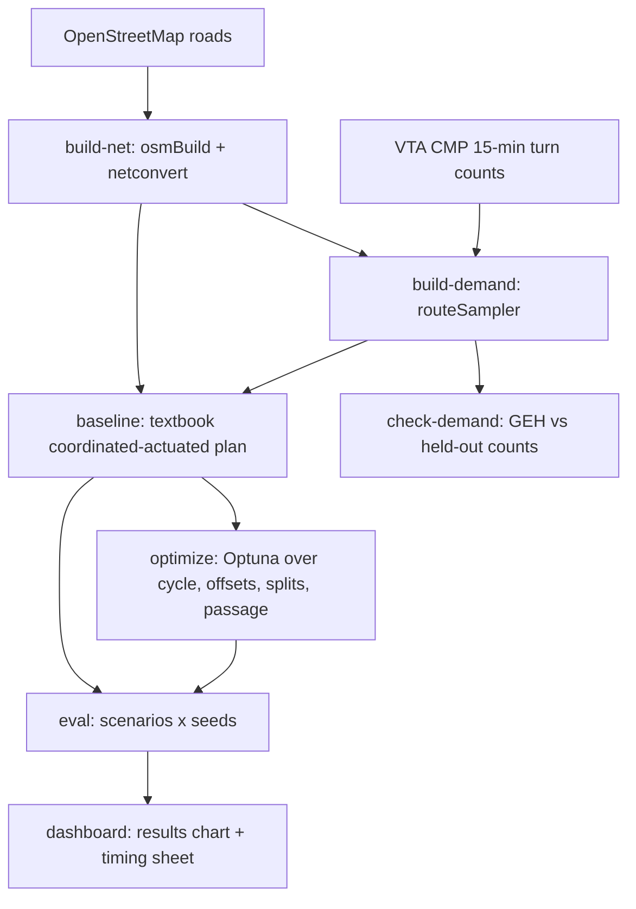

# Cupertino Signal Lab — Architecture & Build Spec

**v3, Oct 21, 2026.** v1 → v2 same day (no filming, actuated, loops). v2 → v3 after three independent
reviews (`reviews/traffic-engineering.md`, `reviews/data-ml-sumo.md`, `reviews/buildability.md`): real
VTA counts replace Google Maps, SUMO's built-in actuated lights replace the custom safety layer, scope
cut to a demo 3 beginners can finish, contracts made exact. For the MVHS AI Club hackathon (theme: a
real City of Cupertino problem; working artifact required; rubric = idea + implementation; teams ≤ 3).

**This file is the hand-off for build agents.** Read all of it before writing code. Code lives in
`~/Documents/school/ai-club-hackathon/`. Section 6 (contracts) is binding; if anything else
disagrees with it, Section 6 wins.

Shareable page: https://claude.ai/artifact/GroVrf1qziHwKqYKF4UYSz (local copy `page.html`)

---

## 1. The idea

Cupertino itself says its corridor timing is out of date. Its RFP **PW-2026-853** (issued Sep 1, 2026,
$210k estimate, under evaluation) asks a consultant to retime Stevens Creek Blvd and De Anza Blvd because
"travel patterns and traffic volumes have changed since prior comprehensive timing efforts". The RFP lists
inconsistent progression, delay near freeway ramps, and side-street inefficiencies
(https://apps.cupertino.org/details/853). The last De Anza retiming gave 9% less travel time, 29% fewer
stops, and a reported 44:1 five-year benefit-cost ratio.

We build an **open, reproducible simulator** of one of those corridors from public data. It tests
retimed coordinated-actuated plans before anyone touches a real light: **decision support for traffic
engineers**, complementary to the city's work, not a replacement for it.

## 2. How the modeled signals work

We do not have Cupertino's timing sheets, so this describes the **model**, not the city's current settings.
City GIS shows corridor cabinets are interconnected and use **induction loops** (no video detectors listed;
`https://gis.cupertino.org/cupgis/rest/services/Public/AmazonData/MapServer/84`).

- **Coordinated-actuated:** neighboring lights share a background **cycle** and **offsets** (green wave).
  Inside the cycle, side streets are served only when a detector calls them.
- **Passage time / gap-out:** after min green, each detector actuation resets a passage timer. If it runs
  out while a conflicting call waits, the phase ends early (gap-out). The phase also ends at max green
  (max-out) or at its force-off point in the cycle.
- **Rest:** with no conflicting calls, the current (main-street) phase stays green.
- **Time-of-day plans:** each plan sets cycle, splits, offsets, max greens, and passage times.
- **Clearances are engineering inputs per movement, not universal constants** (CA MUTCD §4I, MUTCD §4F.17).
  Demo values and how they are derived: Section 6.4.

What we tune: **cycle, offsets, split (max green), passage time**. Phase order stays as generated (no
lead/lag search), so the model never proposes a sequence the ring/barrier structure forbids.

## 3. Facts (verified Oct 21, 2026)

- **Timings:** not public. **Turning counts:** public through VTA. The Congestion Management Program (CMP)
  monitoring appendices hold PM-peak (4:30–6:30 PM) 15-minute turning-movement counts with vehicles,
  heavy vehicles, bikes and pedestrians per crossing. Latest counts are Sep 2024 (odd years). Cupertino CMP
  intersections: **211 De Anza & Stevens Creek**, **212 I-280 SB ramps & De Anza**, **217 Stevens Creek &
  Stelling**, and the I-280 ramps at Wolfe. https://www.vta.org/sites/default/files/2025-08/2024%20CMP%20Monitoring%20Appendices_Sample.pdf
- **Older AM/PM counts** are in the Apple Park DEIR (App. B) and the Vallco DEIR (App. H) traffic studies.
- **Ownership:** city GIS lists the De Anza and Wolfe I-280 ramp-terminal cabinets as **Cupertino-owned and
  -maintained**. Work in Caltrans right-of-way may still need Caltrans coordination.
- **Glenbrook Apartments** = 10100 Mary Ave, across from De Anza College near **Stevens Creek & Mary Ave**.
- **Wolfe/I-280:** under construction (long-term ramp closure from Sep 17, 2026; ~$124M; through ~2029),
  so present traffic there is not representative.
- **Google Maps is not used.** The Maps Platform ToS §3.2.3 forbids storing or caching results and using
  them to validate models. Routes API cannot return past driving times. Billing needs an adult account.
- Adaptive systems: SCOOT centrally makes small cycle/split/offset changes. SCATS combines regional
  strategic timing with local tactical actuation. Surtrac schedules each intersection and sends projected
  outflows to its neighbors.

## 4. Scope

### 4.1 Demo corridor: Stevens Creek Blvd, De Anza Blvd → Mary Ave (5 signals)

Order east → west (from the RFP list): **De Anza Blvd, Bandley Dr, Saich Way, Stelling Rd, Mary Ave**.
Why: this is the Glenbrook backup Saarth saw, it has two CMP count sites (211, 217), and it is inside the
city's own retiming project. Alternative: De Anza Blvd, Homestead → Stevens Creek (Homestead, I-280 NB,
I-280 SB, Mariani, Lazaneo, Stevens Creek; CMP 211, 212). Switching = new `corridor.yaml`, no code change.

### 4.2 Demo definition (must work)

```
python -m signal_lab build-net && python -m signal_lab build-demand \
  && python -m signal_lab check-demand && python -m signal_lab baseline \
  && python -m signal_lab optimize && python -m signal_lab eval
```
- Scenarios: **pm_peak** (16:30–18:30, measured counts) and **night** (23:00–24:00, estimated, shows rest).
- Controllers: **`actuated`** (textbook coordinated-actuated baseline) and **`optuna`** (optimized plan).
- Output: `reports/results.csv`, `reports/timing_pm_peak.csv`, one bar-chart page `dashboard/index.html`.

### 4.3 Stretch (only after 4.2 passes; each is independent)

1. **Max-pressure** controller (Section 7.1).
2. **RL** controller (Section 7.2), not stock sumo-rl.
3. **Estimated AM / school-pickup scenarios** (PM matrix × hour profile, `source=estimated`).
4. **Pedestrians:** crossings + `personFlow`s from the VTA crossing-leg counts, then pedestrian delay.
5. **Side-by-side video and time-space diagram** (fcd output).
6. **City-wide:** more corridors in config. Optimization goes corridor by corridor with boundary signals
   held fixed; heavier runs go to Colab or cloud CPUs.

Out of scope: LODES, Google Maps, custom TraCI safety layer, automatic field deployment.

## 5. System diagram



## 6. Contracts (binding)

### 6.1 Environment
- `.venv` (Python 3.12) has eclipse-sumo 1.28.0, sumo-rl 1.4.5, SB3 2.9.0, gymnasium 1.4.0,
  pettingzoo 1.27.0, pandas.
- M0 adds and pins in `requirements.txt`: `libsumo==1.28.0 optuna scipy pyyaml matplotlib`.
- Every entry point does `import sumo` (it sets `SUMO_HOME`) before `traci`/`sumolib`/`sumo_rl`.
- Use `LIBSUMO_AS_TRACI=1` only after `import libsumo` works. Libsumo allows one sim per process, so
  parallel Optuna trials use separate **processes** (SQLite storage), never threads.

### 6.2 CLI (`src/signal_lab/__main__.py`)
Verbs exactly: `build-net`, `build-demand`, `check-demand`, `baseline`, `optimize`, `eval`, `bench`, `dashboard`.
Each reads `config/corridor.yaml`, writes only its outputs below, and exits non-zero on failure.

### 6.3 `config/corridor.yaml`
```yaml
name: stevens-creek-deanza-to-mary
bbox: null         # build-net computes it from the geocoded signals + 150 m pad, then writes it back
signals:            # east → west; lat/lon + sumo_tls_id filled by build-net
  - {name: De Anza Blvd}
  - {name: Bandley Dr}
  - {name: Saich Way}
  - {name: Stelling Rd}
  - {name: Mary Ave}
mainline_edges: []  # filled by build-net (Stevens Creek both directions)
side_edges: []      # filled by build-net
speed_mph: 35
scenarios:
  pm_peak: {begin: "16:30", end: "18:30", fit: ["16:30","17:30"], holdout: ["17:30","18:30"], source: measured}
  night:   {begin: "23:00", end: "24:00", source: estimated}
seeds: [0, 1, 2]
warmup_s: 900
time_to_teleport: 300
tz: America/Los_Angeles
```
`build-net` geocodes each "Stevens Creek Blvd & <name>, Cupertino" intersection against OSM signal
nodes (Nominatim/Overpass) and fails loudly on a miss. Agents must not invent coordinates.

### 6.4 Signal timing inputs (`data/processed/timing_inputs.csv`, written by `build-net`)
Columns: `sumo_tls_id,phase,movement,speed_mph,grade,width_ft,yellow_s,red_clear_s,min_green_s,max_green_s,passage_s`
- Yellow = `1 + 1.467·V / (20 + 64.4·G)`, V in mph, G decimal grade (0 unless known). Round up to 0.1 s,
  minimum 3.0. At 35 mph = 3.6 s.
- Red clearance = `(W + 20 ft) / (1.467·V)`, rounded to 0.1 s, minimum 1.0. W = intersection width
  from the net.
- Min green: 7 s through, 5 s protected left. Max green: optimizer variable, 10–60 s. Passage: 3.0 s default.
- Pedestrians (stretch): WALK ≥ 7 s; pedestrian change + 2 s buffer ≥ crossing distance / 3.5 ft/s.
- Every row has a `basis` note. These are **demo assumptions, not city values**.

### 6.5 Data files

**Oct 30 data revision:** the emailed VTA/IDAX site 211 and 217 sheets now supply measured 2024-10-09 quarters (16:30–18:30); the public sample still omits those sheets. Complete numeric transcriptions and printed totals are in `vta_counts_2024.csv`, with peak volumes cross-checked against Vistro p2. L/T/R demand excludes UT, retained raw as with Mary. `tmc_sources.csv` records local source locator, page, year, date, method and PDF hash. Bandley/Saich estimates interpolate the 2024 anchors. Westport p28 Mary observations remain 2018-04-25 hourly, with estimated quarters. The source audit quantifies Mary's mixed-year boundary gaps and missing movements. Demand still fits 16:30–17:30 and replays for holdout. Existing optimization/evaluation and presentation artifacts remain labelled 2018 until separately rerun; rebuilding demand does not update them.
- `data/raw/vta/` — the downloaded CMP PDFs (gitignored), plus `data/processed/tmc.csv`:
  `site_id,intersection,approach(N/S/E/W),movement(L/T/R),interval_start(HH:MM),vehicles,heavy,peds,source`.
  Transcribed by hand or by PDF table extraction. A human checks one sheet against the PDF.
- `data/processed/turns_<scenario>.xml` — SUMO `<edgeRelation from to count>` per 15-min `<interval>`,
  mapped from approach/movement to edges by `build-demand`.
- Night: `data/processed/flows_night.csv` `begin_s,end_s,from_edge,to_edge,veh_per_hour,source=estimated`
  (mainline ~10% of PM, side streets a few vehicles per hour).
- Signals without a CMP count (Bandley, Saich, Mary): through volume carries over from the neighbor.
  Side-street volume is estimated and tagged `source=estimated`.

### 6.6 Outputs
- `sim/corridor.net.xml`, `sim/corridor.sumocfg`, `sim/detectors.add.xml` (owner: `build-net`)
- `sim/routes_<scenario>.rou.xml` (owner: `build-demand`)
- `sim/tls_<controller>_<scenario>.add.xml` (owner: `baseline` / `optimize`)
- `reports/demand_check.md` — table `movement,interval,observed,simulated,geh` (owner: `check-demand`)
- `reports/timing_<scenario>.csv` — `sumo_tls_id,cycle_s,offset_s,phase,max_green_s,passage_s`
  (a SUMO timing table, not a controller database)
- `reports/results.csv` — `controller,scenario,seed,mean_time_loss_s,mean_waiting_count,mainline_travel_s,side_time_loss_s,teleports`
  (time loss = tripinfo `timeLoss`, stops = tripinfo `waitingCount`; warm-up excluded)
- `reports/bench.md`, `reports/<step>-REPORT.md`
- Shared edit rights: any step may edit `sim/*.sumocfg` and `reports/`. Nothing else is shared.

## 7. Steps

**M0 · scaffold + bench.** Package, CLI, `requirements.txt`, `.gitignore` (data/raw, keys).
`bench` runs 1 sim hour headless with the baseline and writes wall time to `reports/bench.md`.
Done when every verb exists (`--help`) and `bench` has a number.

**M1 · build-net.** `$SUMO_HOME/tools/osmGet.py -b <bbox>` → `osmBuild.py --vehicle-classes passenger
--netconvert-options "--tls.default-type actuated,--tls.yellow.time 4,--tls.allred.time 1,--osm.turn-lanes,--junctions.join,--tls.join"`
(osmBuild already adds `--tls.discard-simple --output.street-names`). Match the 5 named signals to SUMO
TLS ids. Optional GIS check: query `MapServer/84` (cabinets) and reproject EPSG:2227 → WGS84; many
signal heads = one intersection. Generate stop-bar + upstream E1 detectors (`tools/output/generateTLSE1Detectors.py`;
on edges under 40 m, place the upstream detector at the edge start). Fill `mainline_edges`, `side_edges`,
`timing_inputs.csv`. Done when the net loads, all 5 TLS ids are matched, and a test checks lane counts
on the mainline against a hand-entered fixture of 3 intersections.

**M2 · build-demand.** `tmc.csv` → `turns_pm_peak.xml` (fit window only) → `routeSampler.py -r
<candidate routes from duarouter/randomTrips> -t turns_pm_peak.xml -o sim/routes_pm_peak.rou.xml
--optimize full` (needs scipy). Night from `flows_night.csv`. Done when `sumo -c ... --duration-log.statistics`
finishes for both scenarios with 0 teleports in night.

**M3 · check-demand.** Run pm_peak with the baseline plan. Compare simulated vs observed counts per
movement per 15 min on the **holdout** window. GEH = `sqrt(2(m−c)²/(m+c))` (hourly flows). Report
% of movements with GEH < 5. Target ≥ 85%, but it is a **reported number, not a gate**: if it misses,
the report says why. Call the result a "count-matched PM demand", not a calibrated model of all of Cupertino.

**M4 · baseline (`actuated`).** Per scenario write `tls_actuated_<scenario>.add.xml`: type `actuated`, each
green phase with `minDur` / `maxDur` from 6.4, `next` lists so the main phase can rest and uncalled phases
skip, params `max-gap` (passage), `coordinated=true`, `cycleTime`, `offset`, and `latestEnd` (force-off).
Seed cycle/splits from `tlsCycleAdaptation.py -u -b <begin_s>` (Webster; it writes fixed durations only,
so post-process into minDur/maxDur). Seed offsets from `tlsCoordinator.py`. Label: "textbook
coordinated-actuated baseline (not Cupertino's current timing)". Tests: every green phase has
minDur < maxDur. In night, with no side vehicles, the mainline stays green for the hour, and a side
phase turns green only after a side vehicle arrives.

**M5 · optimize (`optuna`).** Per scenario (pm_peak required): cycle ∈ [80, 150] s; per signal an offset
fraction ∈ [0, 1) × cycle; per signal a Webster mainline multiplier ∈ [0.6, 1.4]; one passage time ∈ [2, 4] s.
That is ~12 dims. Preserve bounded Webster side-phase proportions and nominal slack; enqueue the exact PM baseline as trial 0 because the old split floor/equal side shares excluded it.
Deferred demand adds observed insertion delay plus 1800 s (one drain window) per unfinished vehicle/teleport, avoiding the old full-horizon 6300 s charge.
Objective = mean `timeLoss` on 1 seed with common random numbers, + penalty if mean side-street
timeLoss is > 20% above the baseline on the same seed. 200 trials, then re-score the top 5 on all seeds.
Writes `tls_optuna_<scenario>.add.xml` and `reports/timing_<scenario>.csv`.

**M6 · eval.** Every controller × scenario × seed, same routes, same `time_to_teleport`, warm-up
excluded. Writes `results.csv`. A paired Wilcoxon test over seeds says whether `optuna` beats `actuated`.
The README states the result whichever way it goes.

**M7 · dashboard.** Static `dashboard/index.html` that reads `results.csv` and `timing_*.csv`: one bar
chart of mean time loss per controller per scenario with error bars, plus the timing table. Credits OSM
(ODbL) and VTA.

### 7.1 Stretch: max-pressure (correct definition)
Runs on its own `static` program through TraCI, never mixed with `actuated`. At each legal decision
point (after min green + clearances): movement pressure `w(l,m) = q(l,m) − Σ_p r(m,p)·q(m,p)` (upstream
queue minus turning-ratio-weighted downstream queues). Stage score `Σ c(l,m)·w(l,m)` (c = saturation
flow). Pick the highest-scoring **legal** stage (phases from the net only).

### 7.2 Stretch: RL
Stock sumo-rl **cannot** be used as a safe layer. It rewrites each program to static, drives the lights
directly, has no all-red, a global yellow and min green, and ignores max green. Build a small
`gymnasium.Env` instead. At each decision point (min green reached and a conflicting call waiting),
action per signal = {hold, end phase}. Timing safety is enforced in that env from `timing_inputs.csv`.
Obs = per approach {stop-bar and upstream E1 occupancy, time since last actuation}, phase one-hot, time
in phase (detector data only, no perfect knowledge). Reward = −(halting vehicles on mainline) −
0.2·(halting on side). Train SB3 PPO. Same eval rules as everything else.

## 8. Build order and team split

| Order | Step | Person |
|---|---|---|
| 1 | M0 scaffold + bench | A |
| 2 | M1 build-net | A |
| 2 | VTA counts → `tmc.csv` (human + script, parallel) | B |
| 3 | M2 build-demand, M3 check-demand | B |
| 4 | M4 baseline | C |
| 5 | M5 optimize | C |
| 6 | M6 eval, M7 dashboard | B |

## 9. Compute

The smoke test (1 intersection, sumo-rl, socket TraCI, 20k PPO steps) took ~5 min at under one CPU core.
It does **not** measure this pipeline. Plain `sumo` runs with SUMO's own actuated logic have no Python in
the loop and should be fast. `bench` (M0) gives the real number, and budgets come from it. Rough guess:
optimize = 200 trials × 2 h sim ≈ a few hours, so run it overnight. Everything fits on a MacBook. No GPU needed.

## 10. "One-time or continuous?" in the real world (described, not built)

- Signals react to detectors **every second**. That is the existing actuated logic.
- **Automated Traffic Signal Performance Measures (ATSPM)** monitor high-resolution controller and
  detector events continuously: split failures, arrivals on green, pedestrian delay.
- Engineers **periodically** diagnose problems, run tools like this one to generate candidate plans, then
  **field-pilot, fine-tune, and before/after-evaluate** them (the same steps the city's RFP lists).
  FHWA suggests retiming every 1–3 years. Plan changes need transition handling (offset changes
  disturb coordination for ~1–5 cycles).
- So: continuous **monitoring**, periodic **engineer-approved** retiming. Our tool speeds up the
  "candidate plans" step. No automatic plan pushes or automatic rollback.

## 11. Open questions

1. **Hackathon rules:** may code be built before the event? Ask the club leads before agents build.
   The spec and the VTA count transcription are safe either way.
2. Corridor: Stevens Creek (default) vs De Anza.
3. VTA PDF transcription: hand vs table extraction; one sheet hand-checked either way.
4. Three of the five signals have no direct counts (estimated). State this on the dashboard.
